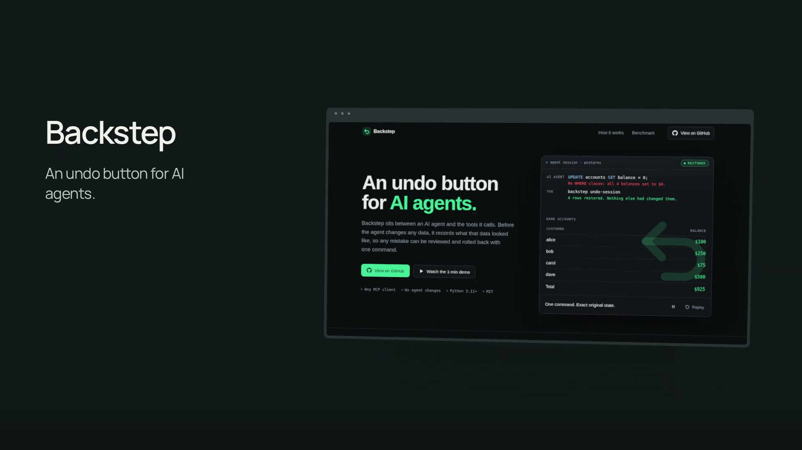

# Pocket Stage

**Turn screenshots into a twelve-second product film.**

Pocket Stage is a browser-based screenshot studio: add one to three screens, write a few lines, choose a visual style, and export a silent **1920 × 1080 H.264 MP4 at 30 fps**. A fixed three-act sequence handles the camera, lighting, detail crop, and closing arrangement.

[Live site](https://pocket-stage.vercel.app/) · [Open studio](https://pocket-stage.vercel.app/studio) · [Watch the Backstep demo](public/demo/backstep-showcase.mp4) · [Download its editable project](public/demo/backstep.pocket-stage.json) · [Source](https://github.com/PeytonR72/pocket-stage)

[](public/demo/backstep-showcase.mp4)

## What you can make

- **Reveal → Detail → Showcase:** a directed, 360-frame sequence with a feature focus you can place on the screenshot.
- **Midnight or Paper:** two themes, preset and custom accent colors, editable product name, captions, and display URL.
- **One to three screenshots:** PNG, JPEG, and WebP inputs; optional Detail and Extra slots. Detail falls back to Main.
- **Frame-level preview:** play, scrub, step, restart, or jump between the three acts. Preview and export use the same composition.
- **Browser export:** capability checks, progress, cancellation, retry, and a download link once a complete MP4 is ready.
- **Local projects:** automatic IndexedDB saving, plus portable `.pocket-stage.json` download and reopening with embedded image bytes.

There is no account, application backend, cloud render queue, or API-key requirement. Image processing and encoding run on the current device. Remotion has its own licensing and usage telemetry; see [Licensing and assets](#licensing-and-assets).

## Run locally

Use **Node.js 22.12+ or Node.js 24**, npm, and a current desktop Chrome browser.

```sh
git clone https://github.com/PeytonR72/pocket-stage.git
cd pocket-stage
npm ci
npm run dev
```

Open the URL Vite prints. The landing page is at `/` (also `/landing`); the editor is at `/studio`.

```sh
npm run build
npm run preview
```

To try the supplied project, download [Backstep's editable demo](public/demo/backstep.pocket-stage.json), open the studio, and choose **Open project**. To make your own, choose **Use my screenshots**, edit the copy, select a theme and detail focus, then choose **Export video**.

Keyboard controls outside text fields: **Space** plays or pauses, **← / →** steps a frame, and **Home** restarts.

## Engineering choices

| Area | Implementation and reason |
| --- | --- |
| Application | React 19, TypeScript, and Vite. The landing page loads first; the studio is a lazy import so its rendering dependencies load when needed. |
| Direction | Pure frame-based functions in [`src/composition/direction.ts`](src/composition/direction.ts) calculate camera/card poses, crops, and copy timing. A given project and frame produce the same scene when scrubbing forward or backward. |
| Scene | Remotion, React Three Fiber, and Three.js provide the shared 3D composition used by the Player and video renderer. Layout and duration stay fixed to keep the editor focused. |
| Export | [`ExportController`](src/export/ExportController.ts) owns state and cancellation separately from editing. Rendering captures project settings and image bytes, waits for fonts and decoded images, and releases export-owned URLs afterward. |
| Images and persistence | Inputs are validated and normalized before replacement. [`ProjectController`](src/model/ProjectController.ts) coordinates edits, image lifetimes, and serialized IndexedDB writes; failed replacements preserve the previous valid image. |
| Portability | Versioned JSON packages embed image bytes instead of temporary object URLs. Reopening validates the package before replacing the current project. |
| Hosting | Static Vite output. [`vercel.json`](vercel.json) includes the build settings and direct studio/landing route rewrites; no server functions are required. |

## Checks

```sh
npm run typecheck
npm run lint
npm test
npm run build
```

The 48 Vitest cases cover frame direction and text bounds, project validation and IndexedDB persistence, asynchronous edit races, portable packages, export state, cancellation, and renderer preparation. Renderer unit tests mock the encoder; the browser check below exercises the built application.

```sh
npx remotion browser ensure
npm run check:frontend
```

The frontend check launches Chrome Headless Shell, checks the landing page and exact demo downloads, plays the supplied MP4, checks narrow layouts, opens `/studio`, and verifies local persistence and demo import. It writes local reports to ignored `qa/`. Set `BASE_URL` to check a deployed instance, or `RENDER=1` to additionally render and download a fresh video through the browser UI. Browser installation may require operating-system libraries.

An optional developer renderer accepts the same embedded project package:

```sh
npm run render:local -- public/demo/backstep.pocket-stage.json proof/backstep.mp4
```

This uses Remotion's Node renderer; the studio's primary export path uses `@remotion/web-renderer` in the browser.

## Current scope

Pocket Stage targets **desktop Chrome** with WebGL and browser H.264 encoding support. The editor checks encoding capability and reports unsupported configurations. Mobile layouts support browsing the demo; mobile editing/export and other browser engines are not verified targets.

Output is fixed at landscape 1080p, 30 fps, twelve seconds, with no audio. Portrait output, a timeline editor, and still-image export are outside the current feature set. Uploads are limited to 10 MiB and 24 megapixels; working images are scaled proportionally to a maximum 2560-pixel long edge. Actual export time depends on the device and browser.

Local storage is tied to the current browser and origin. Clearing browser data or switching devices does not carry a project over; download a project package for a portable backup. A deployment's own hosting requests and Remotion's telemetry mean this is not a zero-network-request application.

## Licensing and assets

The bundled demo features [Backstep](https://github.com/PeytonR72/backstep-ai), Peyton's real project. Its Main and Extra screenshots show the author's product website; Detail is an explicitly labeled excerpt of recorded local CLI output. The website's recovery animation is scripted. The recorded experiment verifies refusal of an irreversible tool and its journal entry; it does not establish a newly performed PostgreSQL recovery. Asset provenance and usage boundaries are documented in [ASSETS.md](ASSETS.md).

Manrope is bundled under the [SIL Open Font License](public/fonts/OFL-Manrope.txt). Dependencies retain their own licenses, including Remotion's [license terms](https://www.remotion.dev/docs/license) and [usage telemetry documentation](https://www.remotion.dev/docs/telemetry). Review Remotion's applicable terms before commercial use.

No blanket source or third-party asset license is granted by this repository at present. Public availability does not change the separate terms of bundled fonts, dependency packages, or Backstep material.
